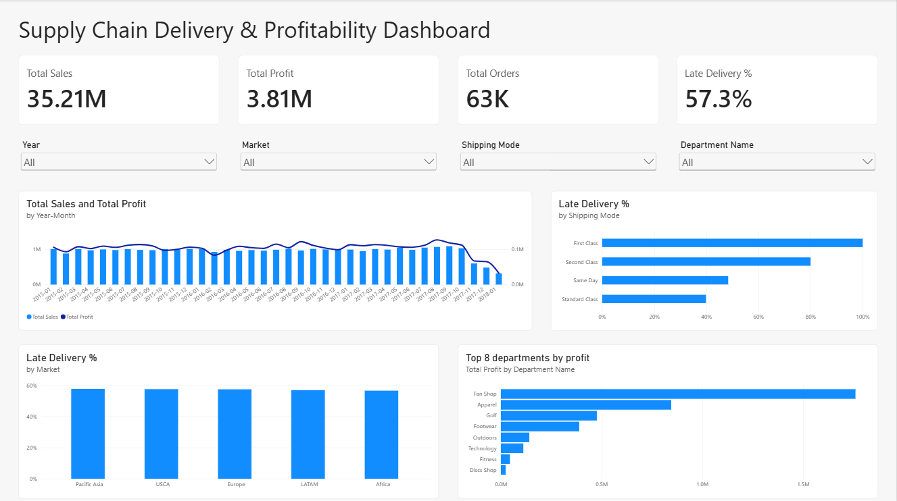
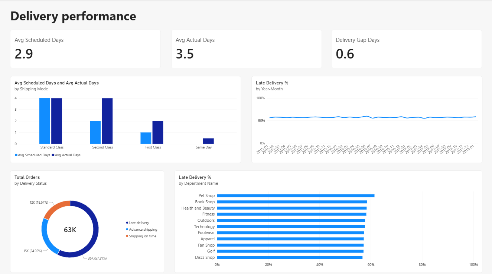

# Supply Chain Delivery & Profitability Dashboard (Power BI)

A two-page Power BI dashboard that analyses delivery performance and profitability for a supply chain, built on the public **DataCo Smart Supply Chain** dataset from Kaggle.

**Tool:** Power BI Desktop (Power Query, DAX, data modelling)
**Author:** Baladharshini

---

## Dashboard preview

### Page 1: Overview


### Page 2: Delivery performance


---

## Business questions

1. How much do we sell, and how much profit do we make?
2. How many orders arrive late, and where is the problem concentrated: shipping mode, market, department, or time period?
3. Is the delivery problem getting better or worse over time?

---

## Dataset

- **Source:** DataCo Smart Supply Chain for Big Data Analysis (Kaggle): https://www.kaggle.com/shashwatwork/dataco-smart-supply-chain-for-big-data-analysis
- **Original data:** Constante, Silva and Pereira, published on Mendeley Data: https://data.mendeley.com/datasets/8gx2fvg2k6/5
- **Period covered:** January 2015 to January 2018
- **Rows after cleaning:** 172,765 order-item rows, representing 62,897 distinct orders
- **Data type:** Historical order data (public dataset, not real company data)

---

## Data preparation (Power Query)

- Removed columns that the dashboard does not use
- Fixed data types
- **Excluded 7,754 order-item rows with Delivery Status "Shipping canceled"** (180,519 rows to 172,765 rows). A cancelled order has no delivery result, so it cannot be counted as on time or late. This was my decision, not a rule in the data.
- Built separate Customers and Products tables from the original flat file
- Created a Date Table for time analysis

## Data model

Star schema with one fact table and three dimension tables:

| Table | Role | Relationship |
|---|---|---|
| Orders | Fact table | — |
| Customers | Dimension | Customers (Customer Id) 1 to many Orders (Customer Id) |
| Products | Dimension | Products (Product Card Id) 1 to many Orders (Product Card Id) |
| Date Table | Dimension | Date Table (Date) 1 to many Orders (Order Date) |

All relationships are single direction and active.

## DAX measures

```
Total Sales = SUM(Orders[Sales])

Total Profit = SUM(Orders[Order Profit Per Order])

Total Orders = DISTINCTCOUNT(Orders[Order Id])

Late Delivery % =
DIVIDE(
    CALCULATE([Total Orders], Orders[Delivery Status] = "Late delivery"),
    [Total Orders]
)

Avg Scheduled Days = AVERAGE(Orders[Days for shipment (scheduled)])

Avg Actual Days = AVERAGE(Orders[Days for shipping (real)])

Delivery Gap Days = [Avg Actual Days] - [Avg Scheduled Days]
```

Calculated columns on the Date Table: `Year` and `Year-Month` (used for the monthly charts).

## Dashboard features

- **Page 1 (Overview):** KPI cards, four slicers (Year, Market, Shipping Mode, Department Name), sales and profit by month, late delivery % by shipping mode, late delivery % by market, and the top 8 departments by profit
- **Page 2 (Delivery performance):** scheduled vs actual days, late delivery % by month, delivery status split, and late delivery % by department
- The four slicers are **synced across both pages**
- Dual-axis chart (sales as columns, profit as a line on its own scale) so profit stays readable
- Percentage axes start at 0% so the charts do not exaggerate small differences

---

## Key findings

**Headline numbers:** 35.21M in sales, 3.81M in profit (about a 10.8% margin), 62,897 orders, and **57.3% of orders delivered late**.

1. **Shipping mode is the main driver of late deliveries.** First Class orders are 100% late and Second Class orders are 80% late. Same Day and Standard Class are much lower (roughly 48% and 40% on the chart).
2. **The lateness in First and Second Class comes from the schedule itself.** First Class is scheduled for 1.0 day but takes 2.0 days on average. Second Class is scheduled for 2.0 days but takes 4.0 days. Standard Class is scheduled for 4.0 days and takes 4.0 days on average. Same Day is scheduled for 0.0 days and takes 0.5 days.
3. **Market and department make little difference.** Late delivery % is about 57% to 58% across all five markets, and about 56% to 61% across all 11 departments (Pet Shop is the highest at about 61%).
4. **Lateness is steady over time.** The monthly late delivery % stays close to 57% for the whole period, so this is a long-running pattern, not a recent problem.
5. **Profit is concentrated in a few departments.** In the top 8 chart, Fan Shop is far ahead of the others, followed by Apparel and Golf.
6. **Sales fall sharply at the end of the data.** Monthly sales drop from about 1.09M in September 2017 to about 0.32M in January 2018, and the decline begins around November 2017.

## Suggested actions (based on the data)

- Review the delivery promises for First Class and Second Class. Either the scheduled times are too short or the actual delivery needs to be faster, since almost every order in these modes misses its schedule.
- Because market and department do not explain lateness, look at shipping mode and carrier handling first.

---

## Limitations

- The dataset is public and historical, so the findings describe this dataset, not a real company.
- I excluded cancelled orders. Including them would change the late delivery %.
- The cause of the sales decline from late 2017 is not stated in the dataset, and January 2018 is much lower than a typical month. I show it as it appears in the data and do not explain it.
- The average-days measures are averages across order-item rows, while Total Orders and Late Delivery % are based on distinct orders.
- "Late" follows the dataset's own Delivery Status field. I did not recalculate it from the dates.
- The "Top 8 departments by profit" chart shows 8 of the 11 departments.

---

## How to open

1. Download `DataCo_Supply_Chain_Dashboard.pbix` (if included in this repo) and open it in Power BI Desktop, or view the screenshots in the `images` folder.
2. If you refresh the data, point the data source to your local copy of the Kaggle CSV.

## Skills demonstrated

Data cleaning in Power Query, star schema modelling, DAX measures, slicer syncing across pages, dashboard layout and chart design, and writing findings with their limits.

---

**Author:** Baladharshini
**LinkedIn:** https://www.linkedin.com/in/baladharshini-s-00420b269/
